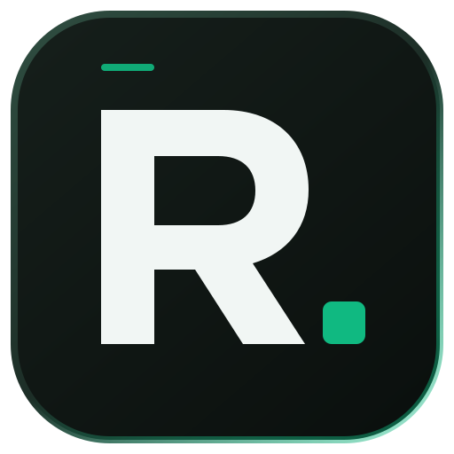
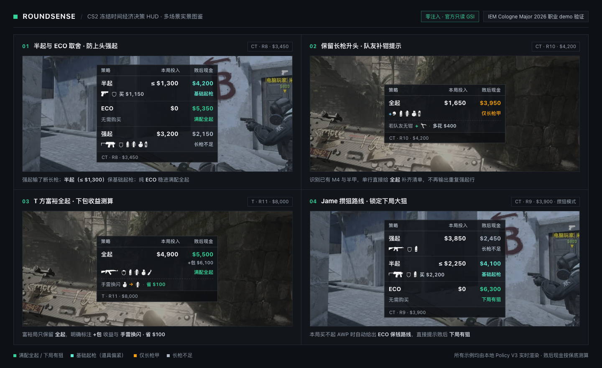
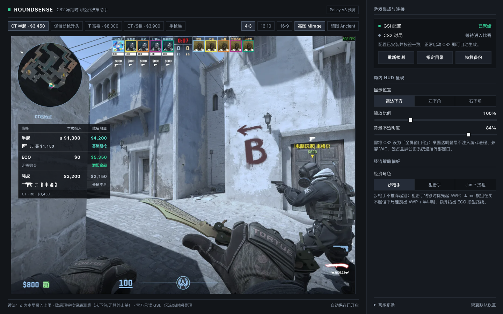
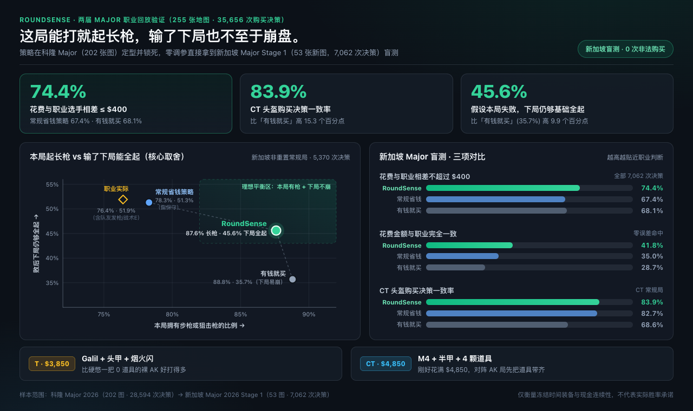

<div align="center">



# RoundSense

**In-game economy assistant for CS2**

Shows buy plans, gear loadouts, and next-round loss cash below your radar during freeze time.<br/>
Uses official read-only CS2 GSI only — no memory reading, no process injection.

[](https://github.com/Starfie1d1272/cs2-roundsense/releases/latest)
[](https://github.com/Starfie1d1272/cs2-roundsense/releases/latest)
[](LICENSE)
[](https://github.com/Starfie1d1272/cs2-roundsense/actions/workflows/ci.yml)
[](https://github.com/Starfie1d1272/cs2-roundsense/releases)

**[Download for Windows](https://github.com/Starfie1d1272/cs2-roundsense/releases/latest)** · [Quick Start](#quick-start-windows-10--11) · [Changelog](CHANGELOG.md) · [简体中文](README.md)

</div>

https://github.com/user-attachments/assets/9ab5cd98-8ef5-4c7f-b473-1b18cfb2ca5c

---

## In-Game HUD



The overlay appears automatically during freeze time, locks the opening buy plan so it stays steady while you purchase, and hides 5 seconds after freeze time ends.

- **Buy plans**: Lists only relevant options for the current round (`Full Buy` / `Force` / `Half Buy` / `ECO` / `AWP Buy`), omitting redundant force rows when a clean full buy is available.
- **Spend & cap**: Standard routes show exact cost; flexible half-buy routes show a **spend cap** (e.g. `≤ $1,300`) alongside a reference loadout cost (e.g. `Buy $1,150`) so you can adjust freely.
- **Gear icons**: Displays native CS2 weapons, armor (including `+Helmet` upgrades), defuse kit, and utility; situational teammate swaps appear as dashed footnotes underneath.
- **Next-round loss cash**: Projects next-round cash under a standard loss (eliminated, no plant, no extra kills; halftime and match-point resets handled automatically) with color-coded tiers:
  - **Emerald (Full Buy / AWP Ready)**: Enough for a full buy with utility next round, or AWP + armor.
  - **Teal (Base Rifle)**: Enough for rifle, armor, and core smoke/flash, with tighter utility or helmet.
  - **Amber (Rifle + Armor Only)**: Rifle and armor only, with almost no utility budget.
  - **Gray (Short of Rifle)**: Spending this much likely forces another ECO if you lose.
  - **T-side `+Plant`**: Shows the extra loss cash if the bomb is planted before losing the round.

---

## Quick Start (Windows 10 / 11)

> **Requirements**: Windows 10 / 11 (64-bit) and Microsoft Edge WebView2 Runtime (pre-installed on Windows 11).  
> **Display mode**: Set CS2 to **Fullscreen Windowed** or **Windowed** so the transparent desktop overlay can render above the game.

1. Download `RoundSense-win64-portable.zip` from the [latest Release](https://github.com/Starfie1d1272/cs2-roundsense/releases/latest) and extract the entire archive.
2. Run `RoundSense.exe` to open the settings and preview window (runtime is bundled; no Node or extra dependencies needed).
3. Click **Install GSI Config** under **Game Integration & Connection** (auto-detects Steam/CS2 and backs up existing configs; you can also browse manually).
4. Adjust HUD placement, scale, opacity, and economy role — changes apply immediately and save automatically.
5. Launch or restart CS2 and join a competitive match. Closing the settings window minimizes RoundSense to the system tray; right-click the tray icon to quit.

---

## Settings & Offline Preview



- **Three economy roles**: Supports `Rifler`, `AWPer`, and `Jame Save AWP` (adds an ECO save-for-AWP line when saving guarantees AWP + Kevlar next round).
- **Offline preview**: Built-in bright (Mirage) and dark (Ancient) backgrounds plus multiple aspect ratios so you can tune HUD position, scale, and opacity without launching CS2.
- **Stays out of the way**: Single-instance desktop app with a click-through, non-focus-stealing overlay. Automatically hides on Alt+Tab, spectating, pistol rounds, or stale data, and cleans up its sidecar process on exit.

---

## Cross-Event Major Validation

The buy rules were calibrated on **IEM Cologne Major 2026** (202 pro maps, 28,594 decisions), then **frozen with zero parameter tuning** and blind-tested on **PGL Singapore Major 2026 · Stage 1** (53 new maps, 7,062 decisions) using only the cash and gear visible to a normal player.



Top-1 recommendation results on the Singapore Stage 1 blind test:

- **Close to pro spending**: **74.4%** of recommendations land within **$400** of actual pro spend (**$460** MAE; **$272** when topping up saved gear), with **41.8%** exact spend matches.
- **Balances current firepower and next-round cash**: Buys a rifle or AWP in **87.6%** of non-reset rounds (close to naive buy-all at 88.8%), while keeping **45.6%** of rounds able to base-rifle next round after a loss (**+9.9 pp** over naive buy-all).
- **Consistent fundamentals**: **77.4%** primary weapon-class agreement, **83.9%** CT helmet agreement, and **0 illegal buys, 0 over-budget rows, and 0 duplicate options** across all 35,656 samples.

Example match situations:

| Situation                       | Common Mistake                                            | RoundSense Recommendation                                                                       |
| :------------------------------ | :-------------------------------------------------------- | :---------------------------------------------------------------------------------------------- |
| **T · $3,850** (standard)       | Buying bare AK + head armor with zero utility             | **Galil + Kevlar/Helmet + Smoke/Molotov/Flash**                                                 |
| **CT · $4,850** (standard)      | Auto-buying helmet and running short on utility           | **M4 + Kevlar + 4 grenades** (exact $4,850 spend against AKs)                                   |
| **CT · $3,450** (loss streak 1) | Spending everything and breaking next round, or saving $0 | **Half-buy cap `≤ $1,300`** (keeps next-round full buy intact), side-by-side with ECO and Force |

<details>
<summary>Full cross-event benchmark table (Cologne dev vs Singapore Stage 1 blind test)</summary>

| Strict 1-vs-1 Top-1 Metric (All Samples)                                             |                            Cologne Dev (`n=28,594`) |                      Singapore S1 Blind (`n=7,062`) |
| :----------------------------------------------------------------------------------- | --------------------------------------------------: | --------------------------------------------------: |
| **Top-1 spend MAE** (vs B0 / B1 / B2)                                                |                    **$472** (vs $555 / $490 / $539) |                    **$460** (vs $547 / $461 / $527) |
| **Top-1 within ≤ $400**                                                              |                **73.2%** (vs 66.7% / 64.2% / 72.0%) |                **74.4%** (vs 68.1% / 67.4% / 74.0%) |
| **Top-1 exact spend match** (vs B0 / B1 / B2)                                        |                **39.7%** (vs 28.3% / 32.9% / 35.4%) |                **41.8%** (vs 28.7% / 35.0% / 36.7%) |
| **Top-1 primary weapon-class match**                                                 |                **76.8%** (vs 69.2% / 77.5% / 72.1%) |                **77.4%** (vs 69.6% / 77.6% / 72.7%) |
| **CT standard-round helmet decision match**                                          |                **83.0%** (vs 71.7% / 80.8% / 76.7%) |                **83.9%** (vs 68.6% / 82.7% / 74.2%) |
| **Current rifle/AWP · next-round base buy on loss** (Pro: 73.1%·51.6% / 76.4%·51.9%) | **86.4% · 44.3%** (B0 86.7%·33.3% / B1 75.3%·51.6%) | **87.6% · 45.6%** (B0 88.8%·35.7% / B1 78.3%·51.3%) |
| **Any-option ≤ $400 coverage / avg options**                                         |                                    **81.8% / 1.55** |                                    **82.6% / 1.52** |
| **Mechanical audit (illegal / duplicate / broken floor)**                            |       **0 / 0 / 0** (legacy V3: 0 / 10,208 / 1,904) |          **0 / 0 / 0** (legacy V3: 0 / 2,524 / 369) |

- Benchmark script: [cross-event-replay-benchmark.ts](scripts/cross-event-replay-benchmark.ts)
- Machine-readable outputs: [cologne-cross-event-benchmark.json](docs/data/cologne-cross-event-benchmark.json) · [singapore-s1-cross-event-benchmark.json](docs/data/singapore-s1-cross-event-benchmark.json)
- Research archive: [docs/research-index.md](docs/research-index.md)
- **Dataset notes**: Loss bonus count is reconstructed (+1 on loss, -1 on win) as `rounds.json` does not store the engine counter directly; `replay.json` records only the held weapon at round end, so carried primary/helmet state uses the prior freeze-end snapshot (large pickup jumps `>$800` are filtered out). Validation measures loadout and cash continuity only, not win-rate guarantees.

</details>

---

## Safety & FAQ

**Q: How does RoundSense read CS2 state? Does it touch the game process?**  
RoundSense only receives read-only local HTTP payloads from Valve's official Game State Integration (`127.0.0.1:3001`) and draws a separate transparent system window on top of the screen. **It never reads or writes game memory, never injects DLLs into `cs2.exe`, never hooks rendering, and never sends simulated input.** As a third-party open-source project we cannot speak for Valve, but the entire app relies strictly on the official read-only GSI interface.

**Q: Why does CS2 need Fullscreen Windowed or Windowed mode?**  
Because RoundSense does not inject into the game's graphics pipeline, the HUD is a standard transparent desktop window. Windows exclusive fullscreen bypasses the desktop compositor and hides external windows; Fullscreen Windowed lets the overlay display cleanly without injection.

**Q: Why is the HUD hidden on pistol rounds, while spectating, or after freeze time?**  
By design: hiding 5 seconds after freeze time keeps your screen clear; pistol-round loadouts depend heavily on personal preference and team calls; spectating and non-competitive modes are hidden by default. RoundSense also does not guess enemy cash or display uncalibrated C4 timers.

---

## Local Data & Logs

- **Windows**: `%LOCALAPPDATA%\RoundSense\` (`hud-settings.json`, `gsi-token`, `gsi-backups\`, `logs\sidecar.log`)
- **macOS / Linux (dev)**: `~/.config/RoundSense/`

---

## Development

```bash
# Install dependencies (Node >= 24.21, pnpm 12.9.1)
pnpm install

# Start local HUD server (open http://127.0.0.1:3100/ for settings & preview)
pnpm hud

# Format check, lint, typecheck, and tests
pnpm format:check
pnpm lint
pnpm typecheck
pnpm test

# Build bundled desktop sidecar
pnpm --filter @roundsense/desktop build:sidecar

# Build desktop host and package Windows portable ZIP (on Windows)
cargo build --release --locked --manifest-path apps/desktop/src-tauri/Cargo.toml
pnpm --filter @roundsense/desktop package:win
```

<details>
<summary>Repository layout</summary>

- `apps/desktop/` — Tauri v2 desktop host (single instance, system tray, sidecar lifecycle, Win32 CS2 overlay tracking)
- `apps/roundsense/` — Local HUD / GSI HTTP+SSE server, CS2 GSI installer, and shared UI
- `packages/economy-advisor/` — CS2 economy rules and Policy V3 recommendation engine
- `packages/gsi-protocol/` — CS2 GSI HTTP receiver, token auth, and protocol parser
- `packages/c4-estimator/`, `packages/replay-harness/`, `packages/shared-types/` — Shared types and replay test harness
- `docs/` — [Research Index](docs/research-index.md), [Policy V3 Architecture](docs/policy-v3-architecture.md), [Final Acceptance Report](docs/experiments/policy-v3-final-acceptance.md)

</details>

## License

[MIT](LICENSE)
