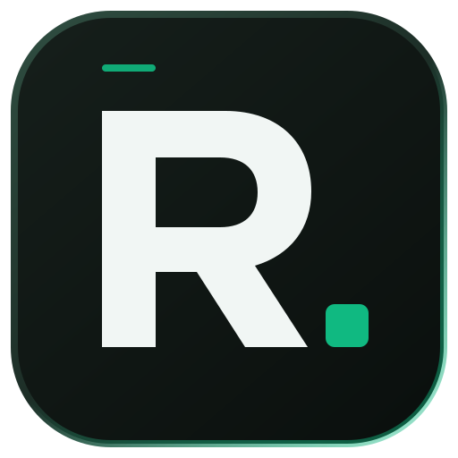
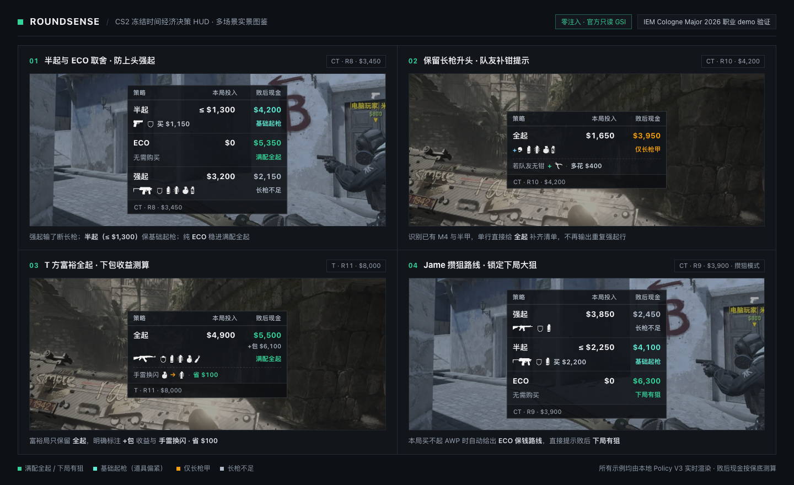
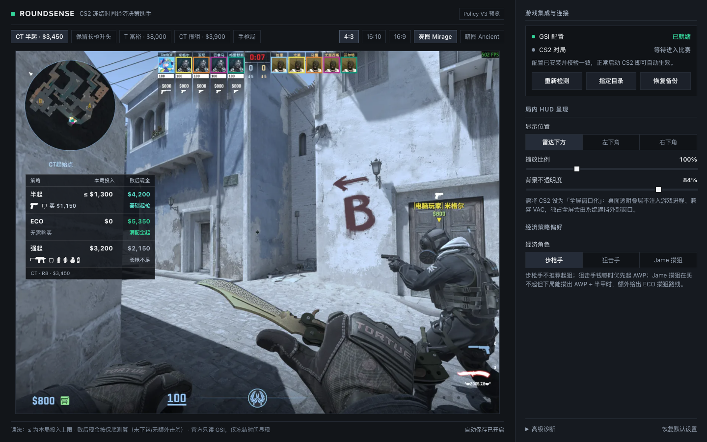
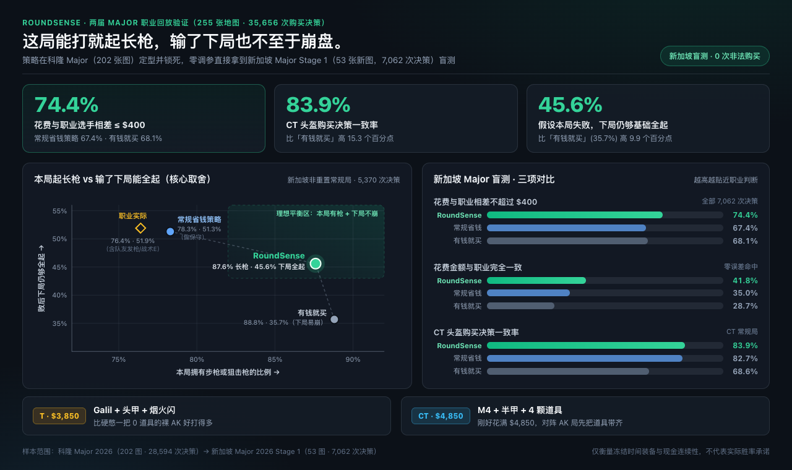

<div align="center">



# RoundSense

**CS2 局内经济助手**

每回合冻结时间，在雷达下方显示购买方案、装备清单和败后下局现金。<br/>
仅使用 CS2 官方只读 GSI，不读内存，不注入进程。

[](https://github.com/Starfie1d1272/cs2-roundsense/releases/latest)
[](https://github.com/Starfie1d1272/cs2-roundsense/releases/latest)
[](LICENSE)
[](https://github.com/Starfie1d1272/cs2-roundsense/actions/workflows/ci.yml)
[](https://github.com/Starfie1d1272/cs2-roundsense/releases)

**[下载 Windows 便携版](https://github.com/Starfie1d1272/cs2-roundsense/releases/latest)** · [快速上手](#快速上手windows-10--11) · [更新日志](CHANGELOG.md) · [English](README.en.md)

</div>

https://github.com/user-attachments/assets/9ab5cd98-8ef5-4c7f-b473-1b18cfb2ca5c

---

## 局内 HUD



HUD 在每回合冻结时间自动出现，开局后锁定当回合方案（买枪过程中不会来回跳动），解冻 5 秒后自动隐藏。

- **购买方案**：只列当前局势下有意义的选项（`全起` / `强起` / `半起` / `ECO` / `起 AWP`），能直接完整全起时不塞冗余行。
- **本局投入**：常规买法显示具体花费；半起等弹性方案显示**花费上限**（如 `≤ $1,300`），配装旁另标参考花费（如 `买 $1,150`），方便按个人习惯微调。
- **装备清单**：直接显示 CS2 原生武器、护甲（含仅补头盔的 `+头盔`）、拆弹器和道具图标；需要配合队友的微调项（如“若队友无钳”“手雷换闪”）以虚线附注在下方。
- **败后下局现金与购买力**：按常规败局（阵亡、未下包、无额外击杀；换边与赛点局自动标记重置）测算下回合现金，并用颜色区分结果：
  - **翠绿（满配全起 / 下局有狙）**：输了下一局仍够满配起枪与道具，或攒出 AWP + 半甲。
  - **青绿（基础起枪）**：输了下一局够长枪配甲加基础烟闪，道具或头盔会略紧。
  - **琥珀（仅长枪甲）**：输了下一局只够裸长枪配甲，基本没有道具预算。
  - **灰白（长枪不足）**：按这行花钱，输了下一局大概率需要重新 ECO。
  - **T 方 `+包`**：额外标出下包后落败的下局现金，方便判断是否值得打埋包。

---

## 快速上手（Windows 10 / 11）

> **运行要求**：Windows 10 / 11（64 位）与 Microsoft Edge WebView2 Runtime（Windows 11 默认自带）。  
> **画面设置**：CS2 需要设为 **全屏窗口化（Fullscreen Windowed）** 或 **窗口模式**，外部透明叠层才能显示在游戏画面之上。

1. 前往 [Releases 页面](https://github.com/Starfie1d1272/cs2-roundsense/releases/latest) 下载最新的 `RoundSense-win64-portable.zip`，完整解压到任意目录。
2. 双击运行 `RoundSense.exe`，打开设置与预览窗口（内置运行时，无需安装 Node 或其他依赖）。
3. 在右侧 **「游戏集成与连接」** 中点击 **一键安装 GSI 配置**（如未自动识别目录，可手动选择 CS2 安装路径；原有配置会自动备份）。
4. 按习惯调整 HUD 位置、缩放、透明度和经济角色，修改即时生效并自动保存。
5. 启动或重启 CS2 进入竞技模式即可。平时可直接关闭设置窗口让程序驻留系统托盘，右键托盘图标可退出。

---

## 设置与离线预览



- **三种经济角色**：支持 `步枪手`、`狙击手` 和 `Jame 攒狙`（当前买不起但下局能攒出 AWP + 半甲时，额外给出 ECO 攒狙路线）。
- **离线调布局**：内置亮图（Mirage）与暗图（Ancient）及多分辨率预览，不开游戏也能调好雷达下方位置、缩放和透明度。
- **克制的运行方式**：单实例运行、叠层鼠标穿透且不抢游戏焦点；切出游戏、进入观战、手枪局或数据过期时自动隐藏；退出时自动回收后台进程。

---

## 两届 Major 回放验证

起枪规则先在 **IEM Cologne Major 2026**（202 张职业地图、28,594 次决策）上定型，随后**锁死参数不做任何微调**，直接在 **PGL Singapore Major 2026 · Stage 1**（53 张新图、7,062 次决策）上做盲测。整个过程只输入普通玩家在游戏里能看到的金钱和装备。



以下为新加坡 Stage 1 盲测中第 1 推荐方案的结果：

- **花费接近职业习惯**：**74.4%** 的决策与职业选手实际花费相差不超过 **$400**（平均差 **$460**，保枪补装平均差 **$272**），**41.8%** 金额完全一致。
- **兼顾本局火力与下局经济**：非重置常规局中，**87.6%** 能起出步枪或狙击枪（接近「有钱就买」的 88.8%），同时败后下局仍够基础全起的比例达到 **45.6%**（比「有钱就买」高 **9.9 个百分点**）。
- **基础判断稳定**：主武器类别一致率 **77.4%**，**CT 头盔购买决策一致率 83.9%**；全部 35,656 条样本中 **0 次非法购买、0 次超预算、0 次重复方案**。

常见对局场景示例：

| 场景                         | 常见误区                         | RoundSense 建议                                                               |
| :--------------------------- | :------------------------------- | :---------------------------------------------------------------------------- |
| **T · $3,850**（常规局）     | 强买裸 AK + 头甲，没有道具       | **Galil + 头甲 + 烟火闪**，保证基本进点道具                                   |
| **CT · $4,850**（常规局）    | 习惯先买头甲，道具只剩两颗       | **M4 + 半甲 + 4 颗道具**（刚好花满 $4,850，对阵 AK 优先带齐道具）             |
| **CT · $3,450**（连败 1 局） | 要么全花光拖垮下局，要么 $0 纯省 | 给出 **半起上限 `≤ $1,300`**（输了下局仍够全起），同时并排显示 ECO 与强起对比 |

<details>
<summary>展开完整跨赛事对照表（科隆开发集 vs 新加坡 S1 盲测）</summary>

| 严格 1-vs-1 首选指标（全部样本）                                               |                              科隆开发集 (`n=28,594`) |                           新加坡 S1 盲测 (`n=7,062`) |
| :----------------------------------------------------------------------------- | ---------------------------------------------------: | ---------------------------------------------------: |
| **首选购买金额平均偏差 MAE**（vs B0 / B1 / B2）                                |                    **$472**（vs $555 / $490 / $539） |                    **$460**（vs $547 / $461 / $527） |
| **首选误差 ≤ $400**                                                            |                **73.2%**（vs 66.7% / 64.2% / 72.0%） |                **74.4%**（vs 68.1% / 67.4% / 74.0%） |
| **首选金额完全一致**（vs B0 / B1 / B2）                                        |                **39.7%**（vs 28.3% / 32.9% / 35.4%） |                **41.8%**（vs 28.7% / 35.0% / 36.7%） |
| **首选主武器类别一致率**                                                       |                **76.8%**（vs 69.2% / 77.5% / 72.1%） |                **77.4%**（vs 69.6% / 77.6% / 72.7%） |
| **CT 常规局头盔购买决策一致率**                                                |                **83.0%**（vs 71.7% / 80.8% / 76.7%） |                **83.9%**（vs 68.6% / 82.7% / 74.2%） |
| **本局步枪/狙持有率 · 败后下局基础全起**（职业实际 73.1%·51.6% / 76.4%·51.9%） | **86.4% · 44.3%**（B0 86.7%·33.3% / B1 75.3%·51.6%） | **87.6% · 45.6%**（B0 88.8%·35.7% / B1 78.3%·51.3%） |
| **备选方案 ≤ $400 覆盖 / 平均方案数**                                          |                                     **81.8% / 1.55** |                                     **82.6% / 1.52** |
| **机械审计（非法或超限 / 重复方案 / 半起破底线）**                             |         **0 / 0 / 0**（旧版 V3: 0 / 10,208 / 1,904） |            **0 / 0 / 0**（旧版 V3: 0 / 2,524 / 369） |

- 复现脚本：[cross-event-replay-benchmark.ts](scripts/cross-event-replay-benchmark.ts)
- 原始结果：[cologne-cross-event-benchmark.json](docs/data/cologne-cross-event-benchmark.json) · [singapore-s1-cross-event-benchmark.json](docs/data/singapore-s1-cross-event-benchmark.json)
- 研究归档：[docs/research-index.md](docs/research-index.md)
- **数据说明**：语料 `rounds.json` 未单独记录引擎连败计数，按胜局减 1、败局加 1 推算；`replay.json` 仅记录回合末手持武器，存活保留的主武器与头盔沿用上回合冻结结束记录（大额捡枪跳变已通过 `>$800` 过滤排除）。验证仅衡量装备与现金连续性，不代表胜率承诺。

</details>

---

## 安全说明与常见问题

**Q：RoundSense 如何读取游戏数据？会不会碰游戏进程？**  
RoundSense 只通过 Valve 官方本地 HTTP Game State Integration（`127.0.0.1:3001`）接收只读状态，并以独立的系统透明置顶窗口显示叠层。**不读取或修改游戏内存，不向 `cs2.exe` 注入 DLL，不挂钩渲染，也不模拟键鼠输入。** 作为第三方开源工具，我们不能替 Valve 做绝对保证，但整个工具严格只走官方只读接口。

**Q：为什么必须用「全屏窗口化」或「窗口模式」？**  
正因为不注入游戏渲染，HUD 是一个普通的系统透明顶层窗口。Windows 下独占全屏会由显卡驱动接管画面并遮挡外部窗口，切到全屏窗口化即可正常显示。

**Q：为什么手枪局、观战或回合开始后不显示？**  
刻意如此设计：解冻 5 秒后隐藏避免挡视野；手枪局配装高度依赖个人与战术安排；观战和非竞技模式默认隐藏。此外，RoundSense 也不猜测对手精确金钱，也不提供未校准的 C4 倒计时。

---

## 本地数据与日志

- **Windows**：`%LOCALAPPDATA%\RoundSense\`（`hud-settings.json`、`gsi-token`、`gsi-backups\`、`logs\sidecar.log`）
- **macOS / Linux（开发模式）**：`~/.config/RoundSense/`

---

## 开发者指南

```bash
# 安装依赖（Node >= 24.21, pnpm 12.9.1）
pnpm install

# 启动本地 HUD 服务（浏览器访问 http://127.0.0.1:3100/ 调试设置与预览）
pnpm hud

# 格式化、Lint、类型检查与测试
pnpm format:check
pnpm lint
pnpm typecheck
pnpm test

# 构建桌面端单文件 Sidecar
pnpm --filter @roundsense/desktop build:sidecar

# 在 Windows 上编译桌面宿主并打包便携 ZIP
cargo build --release --locked --manifest-path apps/desktop/src-tauri/Cargo.toml
pnpm --filter @roundsense/desktop package:win
```

<details>
<summary>仓库结构</summary>

- `apps/desktop/` — Tauri v2 原生桌面宿主（单实例、系统托盘、Sidecar 生命周期、Win32 CS2 窗口定位）
- `apps/roundsense/` — 本地 HUD / GSI HTTP+SSE 服务、CS2 GSI 自动配置与共享 UI
- `packages/economy-advisor/` — CS2 经济规则表与 Policy V3 推荐引擎
- `packages/gsi-protocol/` — CS2 GSI HTTP 接收器、Token 认证与协议解析
- `packages/c4-estimator/`、`packages/replay-harness/`、`packages/shared-types/` — 共享类型与回放测试基础设施
- `docs/` — [研究归档索引](docs/research-index.md)、[Policy V3 架构](docs/policy-v3-architecture.md)、[最终验收报告](docs/experiments/policy-v3-final-acceptance.md)

</details>

## License

[MIT](LICENSE)
