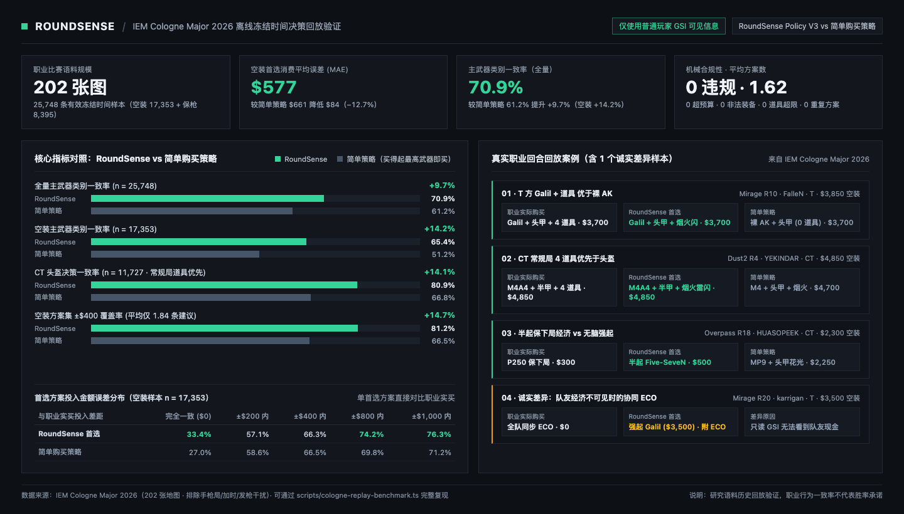

# RoundSense

**简体中文** | [English](README.en.md)

**只读、零注入的 CS2 冻结时间经济决策 HUD。**  
在每回合 15 秒冻结时间里，于雷达下方用 1–2 秒帮你看清三个最关键的问题：**这局最多值多少？预算内买什么？输了下一局还能不能全起？** 回合开始后自动隐藏，绝不打扰对枪。

---

## 为什么做 RoundSense？

很多 CS2 经济工具要么只给你丢一套固定配装，要么像外挂一样读内存。RoundSense 的起枪逻辑基于 **IEM Cologne Major 2026 职业比赛 demo（200+ 张地图、超过 2 万个有效回合）** 总结而来，不替你做唯一决定，而是把所有合理的起枪路线和后果并排摊开：

1. **帮新人真正看懂 CS2 经济系统**  
   不用死背“什么时候该起、什么时候该 E”。直接对照职业选手的常见起枪方式，一眼看清全起、强起、半起、ECO 分别会带来什么结果——为什么这局不能强起、半起最多花多少、为什么有时候必须保钱。
2. **帮老玩家和指挥防上头**  
   连败或焦灼局最容易一时上头无脑强起。RoundSense 直接把**强起的代价**摆在眼前（这局输了下一局剩多少钱、还能不能全起），帮你和队友在 15 秒内冷静判断该拼还是该 E。

> 对策略研究过程与职业语料验收细节感兴趣的玩家或开发者，可以查阅 [研究归档索引](docs/research-index.md)。

---

## 30 秒看懂局内 HUD


局内叠层只保留扫一眼就能做决定的信息，没有任何废话：

- **策略列**：只展示当前最有价值的几种购买方案（`全起` / `强起` / `半起` / `ECO` / `起 AWP`）及其对下一局经济的影响，能直接完整全起时不塞冗余强起行。
- **本局投入**：常规买法显示具体花费；半起等弹性路线优先显示**投入上限（如 `≤ $1,300`）**，下方配装旁再标出参考花费（如 `买 $1,150`），方便你按手感和队友沟通灵活微调。
- **配装剪影**：直接显示原生 CS2 武器、护甲（含仅补头盔的 `+头盔`）、拆弹器与道具图标；需要队友配合的替换方案（如“若队友无钳”“手雷换闪”）会以虚线附注在下方。
- **败后现金与下局购买力**：按最保守的保底收入（未下包、无额外击杀）测算本局落败后的下局现金，并用颜色直觉标出结果：
  - **翠绿（满配全起 / 下局有狙）**：输了下一局依然能满配起枪、道具充足（或攒出 AWP + 半甲）。
  - **青绿（基础起枪）**：输了下一局够买长枪配甲加基础烟闪，但道具/头盔/钳子会偏紧。
  - **琥珀色（仅长枪甲）**：输了下一局只够裸长枪配甲，几乎没有道具预算。
  - **灰白色（长枪不足）**：这局这样花钱，输了下一局大概率得重新 ECO。
  - **T 方 `+包`**：额外标出下包后落败的保底现金，方便评估埋包收益。

---

## 职业比赛回放验证（IEM Cologne Major 2026）

我们在 **202 张 IEM Cologne Major 2026 职业比赛地图、25,748 条有效冻结时间决策样本**（含空装起枪与保枪补装备，仅输入普通玩家 GSI 可见信息）上做了离线回放对比，将 RoundSense 与「买得起最高武器即买」的简单策略直接对照职业选手真实购买行为：



- 完整机器可读统计与真实案例见 [cologne-replay-benchmark.json](docs/data/cologne-replay-benchmark.json)，可通过 [cologne-replay-benchmark.ts](scripts/cologne-replay-benchmark.ts) 复现。
- 说明：以上为基于研究语料的历史冻结时间回放验证；职业行为一致率衡量决策贴近度，不代表胜率承诺。

---

## 核心特性

- **解压即用**：Windows 便携 ZIP 内置完整 Node 运行时与本地服务，无需安装 Node、pnpm 或 Rust。
- **绝对只读、兼容 VAC**：仅使用 CS2 官方本地 HTTP Game State Integration（`127.0.0.1:3001`）与只读 Win32 窗口定位，**绝不读取或修改游戏内存，不注入游戏进程**。
- **克制且诚实**：不编造拿不到的对手精确现金，不提供未经校准的 C4 倒计时；一旦离开冻结时间、切出游戏、进入观战或数据超时，HUD 自动隐藏。
- **三种经济角色**：支持 `步枪手`、`狙击手` 与 `Jame 攒狙`（买不起但下局能攒出 AWP + 半甲时，额外给出 ECO 攒狙路线）。
- **一键配置与离线预览**：自动发现 Steam / CS2 目录并一键写入 GSI 配置（自动检测同端口冲突并备份原配置）；设置页内置亮/暗图与多比例离线场景，不开游戏也能先调好位置、缩放和透明度。
- **安静的桌面体验**：单实例运行、关闭设置窗自动缩入系统托盘、叠层鼠标穿透且不抢游戏焦点；退出或异常关闭时通过 Windows Job Object 自动回收后台进程。

---

## 设置与离线预览工作台


## 上手指南（Windows 10 / 11）

> 运行要求：Windows 10 / 11（64 位）与系统内置的 Microsoft Edge WebView2 Runtime（Windows 11 默认自带）。  
> **重要**：CS2 需设为 **全屏窗口化（Fullscreen Windowed）** 或窗口模式，桌面透明叠层才能显示在游戏画面之上。

1. 从 GitHub Releases / Actions 下载 Windows 便携版 ZIP 压缩包并完整解压到任意目录。
2. 双击运行 `RoundSense.exe`，打开设置与预览窗口。
3. 在右侧 **「游戏集成与连接」** 中点击 **一键安装 GSI 配置**（如未自动找到目录，可点击 **浏览…** 选择 CS2 安装目录）。
4. 按习惯调整 HUD 位置（雷达下方 / 左下角 / 右下角）、缩放比例、背景不透明度与经济角色，所有修改即时生效并自动保存。
5. 启动（或重启）CS2 进入竞技模式，每回合冻结时间 HUD 自动出现，回合开始或 `Alt+Tab` 切出后自动隐藏。
6. 平时可直接关闭设置窗口让它安静驻留系统托盘；需要完全退出时，右键托盘图标选择 **退出 RoundSense**。

---

## 常见问答（FAQ）

**Q：RoundSense 如何与 CS2 交互？安全性如何？**  
RoundSense 仅通过 Valve 官方提供的本地 Game State Integration（GSI）HTTP 推送接收只读状态，并以独立的系统透明置顶窗口渲染叠层——**不读取或修改游戏内存、不向 `cs2.exe` 注入任何 DLL、不钩子游戏渲染、也不模拟任何键盘鼠标输入**。作为第三方开源工具，我们无法替 Valve 提供绝对的反作弊保证，但整个架构严格恪守只读零注入边界。

**Q：为什么必须把 CS2 设为「全屏窗口化」？**  
正因为 RoundSense 坚持不注入游戏进程，HUD 以独立的系统透明置顶窗口渲染。Windows 下独占全屏会由显卡驱动接管画面并遮挡外部窗口，切到「全屏窗口化」即可在零注入的前提下正常显示。

**Q：为什么手枪局、观战或回合开始后看不到 HUD？**  
这是刻意设计：回合开始后自动隐藏，避免遮挡视野；手枪局配装高度依赖个人与战术习惯，不强行建议；观战或非竞技模式同样自动隐藏。

---

## 本地数据与日志位置

- **Windows**：`%LOCALAPPDATA%\RoundSense\`（包含 `hud-settings.json`、`gsi-token`、`gsi-backups\`、`logs\sidecar.log`）
- **macOS / Linux（开发模式）**：`~/.config/RoundSense/`

---

## 开发者指南

```bash
# 安装依赖（Node >= 24.21, pnpm 12.9.1）
pnpm install

# 启动本地 HUD 服务（浏览器打开 http://127.0.0.1:3100/ 调试设置页与预览）
pnpm hud

# 格式化、Lint、类型检查与全量测试
pnpm format:check
pnpm lint
pnpm typecheck
pnpm test

# 构建桌面端单文件 Sidecar
pnpm --filter @roundsense/desktop build:sidecar

# 编译桌面宿主并打包 Windows 便携 ZIP（在 Windows 上运行）
cargo build --release --locked --manifest-path apps/desktop/src-tauri/Cargo.toml
pnpm --filter @roundsense/desktop package:win
```

## 仓库结构

- `apps/desktop/` — Tauri v2 原生桌面宿主（单实例、系统托盘、Node Sidecar 生命周期、Win32 CS2 叠层定位）
- `apps/roundsense/` — 本地 HUD/GSI HTTP+SSE 服务、CS2 GSI 自动配置与共享 HUD / 设置页 UI
- `packages/economy-advisor/` — CS2 竞技经济规则表与 Policy V3 推荐引擎
- `packages/gsi-protocol/` — CS2 GSI HTTP 接收器、Token 认证与协议解析
- `packages/c4-estimator/`、`packages/replay-harness/`、`packages/shared-types/` — 共享类型与回放测试基础设施
- `docs/` — [研究归档索引](docs/research-index.md)、[Policy V3 架构锁定](docs/policy-v3-architecture.md) 与 [最终验收报告](docs/experiments/policy-v3-final-acceptance.md)

## License

MIT
